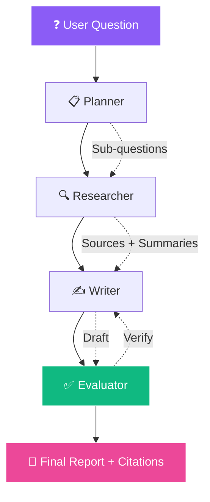

<!-- ═══════════════════════════════════════════════════════════════ -->
<!-- 🤖 Multi-Agent Research — Working AI README -->
<!-- ═══════════════════════════════════════════════════════════════ -->

<!-- ═══════ ANIMATED HEADER (8D Vibe) ═══════ -->
<div align="center">
  
</div>

<!-- ═══════ AI MASCOTS (Working) ═══════ -->
<div align="center">
  
  
  
  
  
</div>

<br/>

<!-- ═══════ TERMINAL AI (Animated Typewriter) ═══════ -->
<div align="center">
  
</div>

<br/>

<!-- ═══════ AI SCENES (Working) ═══════ -->
<div align="center">
  
  
  
</div>

<br/>

<!-- ═══════ LIVE BADGES ═══════ -->
<div align="center">
  <a href="https://github.com/sumit966/multi-agent-research/stargazers">
    
  </a>
  <a href="https://github.com/sumit966/multi-agent-research/network/members">
    
  </a>
  <a href="https://github.com/sumit966/multi-agent-research/issues">
    
  </a>
  <a href="https://github.com/sumit966/multi-agent-research/commits/main">
    
  </a>
</div>

<br/>

<div align="center">
  
  
  
  
  
</div>

<br/>

<div align="center">
  
  
  
  
</div>

<br/>

<div align="center">
  <i>🤖 AI Agent Project · Author: <b>Sumit Raj</b> · M.Tech VNIT Nagpur · Ex-Salesforce</i>
</div>

<br/>


---

## 🎯 Overview


Instead of sending a single prompt to an LLM, this project **decomposes a research task into four specialized agents** that pass structured state between them:

<table>
<tr>
<td width="25%" align="center">

### 1️⃣ Planner


Decomposes into 3-4 sub-questions

</td>
<td width="25%" align="center">

### 2️⃣ Researcher


Calls search tool per sub-question

</td>
<td width="25%" align="center">

### 3️⃣ Writer


Synthesizes findings

</td>
<td width="25%" align="center">

### 4️⃣ Evaluator


Verifies claims

</td>
</tr>
</table>

> **🎯 Purpose:** Reduce hallucination, add structure, enable transparency.

<br clear="right"/>

---

## ❌ Problem Statement

Single-shot LLM answers have **well-known problems**:

| ❌ Issue | Impact |
|---------|--------|
| 🎭 **Hallucination** | Invents plausible-sounding facts |
| 📉 **No structure** | Rambling, disorganized answers |
| 🔍 **No verification** | Claims unchecked |
| 🚫 **No transparency** | Can't see how answer was built |

**For research tasks, these failures are unacceptable.**

---

## ✅ Solution

A multi-agent pipeline that:

- **📋 Plans** the research systematically
- **🔍 Gathers** evidence from sources with tool calling
- **✍️ Writes** structured reports with clear sections
- **✅ Evaluates** the draft against sources (reduces hallucination)
- **🛡️ Falls back to MockLLM** when no API key is set

---

## 🏗️ Architecture

### 🧠 Agent Pipeline Flow



### 📐 ASCII Fallback

```
User Question
     |
     v
+-------------+
|  Planner    |  Breaks question into sub-questions
+------+------+
       |
       v
+-------------+
| Researcher  |  For each sub-question: calls search tool,
|             |  summarizes evidence
+------+------+
       |
       v
+-------------+
|  Writer     |  Synthesizes all findings into a structured report
+------+------+
       |
       v
+-------------+
| Evaluator   |  Checks each claim against sources (self-reflection)
+------+------+
       |
       v
Final Report + Citations
```

---

## 🛠️ Tech Stack

<table align="center">
<tr>
<td><b>Category</b></td>
<td><b>Technologies</b></td>
</tr>
<tr>
<td>🎯 Orchestration</td>
<td></td>
</tr>
<tr>
<td>🔗 LLM Framework</td>
<td> </td>
</tr>
<tr>
<td>🤖 LLM</td>
<td> </td>
</tr>
<tr>
<td>🌐 API</td>
<td>  </td>
</tr>
<tr>
<td>🔍 Tools</td>
<td></td>
</tr>
<tr>
<td>🧪 Testing</td>
<td> </td>
</tr>
<tr>
<td>🐳 Container</td>
<td></td>
</tr>
<tr>
<td>⚙️ CI/CD</td>
<td></td>
</tr>
<tr>
<td>🐍 Language</td>
<td></td>
</tr>
</table>

---

## 📦 Project Structure

```
multi-agent-research/
│
├── 🐍 src/
│   ├── __init__.py
│   ├── 🤖 agents.py          # 4 agents + pipeline orchestrator
│   └── 🎭 mock_llm.py        # MockLLM + MockSearchTool for offline mode
│
├── 🌐 api/
│   ├── __init__.py
│   └── main.py               # FastAPI service exposing /research
│
├── 🧪 tests/
│   ├── __init__.py
│   └── test_api.py           # pytest tests
│
├── 📊 data/                   # For future report caching
├── ⚙️ .github/workflows/ci.yml
├── 🐳 Dockerfile
├── 📋 requirements.txt
├── 📋 requirements-optional.txt
├── 🔐 .env.example
├── 🚫 .gitignore
├── 📜 LICENSE
└── 📖 README.md
```

---

## 🚀 Quick Start

<div align="center">
  
  
</div>

<br/>

### 1️⃣ Clone

```bash
git clone https://github.com/sumit966/multi-agent-research.git
cd multi-agent-research
```

### 2️⃣ Virtual Environment

**Windows:**

```bash
python -m venv venv
venv\Scripts\activate
```

**macOS / Linux:**

```bash
python3 -m venv venv
source venv/bin/activate
```

### 3️⃣ Install Base Dependencies

```bash
pip install -r requirements.txt
```

### 4️⃣ (Optional) Install LangGraph + OpenAI

```bash
pip install -r requirements-optional.txt
```

> 💡 If this fails on Python 3.14, skip it. The project **automatically falls back to MockLLM**.

### 5️⃣ (Optional) Configure OpenAI

```bash
cp .env.example .env
# Set OPENAI_API_KEY and LLM_MODEL
```

> If you skip this step, the pipeline uses **MockLLM** and still runs end-to-end.

### 6️⃣ Start the API

```bash
uvicorn api.main:app --reload
```

**API runs at** http://localhost:8000

### 7️⃣ Open Swagger UI

```bash
http://localhost:8000/docs
```

---

## 🔌 API Usage

### 🔵 POST `/research`

**Request:**

```json
{
  "question": "What is retrieval-augmented generation?",
  "max_plan_steps": 5
}
```

**Response:**

```json
{
  "question": "What is retrieval-augmented generation?",
  "plan": [
    "1. Define RAG precisely.",
    "2. Break it into retrieval + generation components.",
    "3. Gather evidence on real-world usage.",
    "4. Synthesize into a structured answer."
  ],
  "findings": [
    {
      "sub_question": "1. Define RAG precisely.",
      "sources": [
        {
          "title": "Source 1 on 1. Define RAG precisely.",
          "url": "https://example.com/source-1",
          "snippet": "Relevant content for: 1. Define RAG..."
        }
      ],
      "summary": "Findings for query: 1. Define RAG precisely..."
    }
  ],
  "evaluation": "PASS - All claims are supported by the provided sources.",
  "final_report": "Report:\n\nBased on the research provided..."
}
```

### 📋 Other Endpoints

| Endpoint | Method | Purpose |
|----------|:------:|---------|
| 🔵 `/` | 🟢 GET | API info |
| 💚 `/health` | 🟢 GET | Health check |
| 📘 `/docs` | 🟢 GET | Swagger UI |
| 📗 `/redoc` | 🟢 GET | Alternative docs |

### 🐚 cURL Example

```bash
curl -X POST "http://localhost:8000/research" \
  -H "Content-Type: application/json" \
  -d '{"question": "What is retrieval-augmented generation?", "max_plan_steps": 5}'
```

---

## 🤖 Agent Design

<table align="center">
<tr>
<td width="25%" valign="top" align="center">

### 📋 Planner


Prompt: "Break this research question into 3-4 sub-questions"

**Output:** Ordered list of sub-questions

</td>
<td width="25%" valign="top" align="center">

### 🔍 Researcher


Calls `SEARCH_TOOL.search(sub_question, top_k=3)`

**Output:** List of `{sub_question, sources, summary}`

</td>
<td width="25%" valign="top" align="center">

### ✍️ Writer


Combines question + all findings

**Output:** Draft report with Overview, Key Points, Conclusion

</td>
<td width="25%" valign="top" align="center">

### ✅ Evaluator


Prompt: "Verify that each claim is supported by sources."

**Output:** PASS or FAIL with explanation

</td>
</tr>
</table>

---

## 🛡️ Offline Mode

If `OPENAI_API_KEY` is missing OR `langchain-openai` is not installed:

- The system uses **MockLLM** (deterministic template responses)
- The search tool returns **synthetic source results**
- The pipeline still runs **end-to-end** with the same interface

**This makes the project:**
- ✅ Fully testable in CI without API keys
- ✅ Runnable on any machine for demos
- ✅ Easy to swap in real LLMs later

---

## 🧪 Testing

```bash
pytest tests/ -v
```

**Tests cover:**

- 🟢 Root endpoint responds correctly
- 💚 Health check returns expected status
- 🔵 `/research` returns plan, findings, evaluation, and final_report
- ❌ Invalid question (too short) returns **422** validation error

---

## 🐳 Docker

### 🔨 Build

```bash
docker build -t multi-agent-research .
```

### ▶️ Run

```bash
docker run -p 8000:8000 multi-agent-research
```

---

## ⚙️ CI/CD Pipeline

Every push to `main` triggers GitHub Actions:

```
╔══════════════════════════════════════════════════╗
║              GITHUB ACTIONS WORKFLOW             ║
╠══════════════════════════════════════════════════╣
║                                                  ║
║  [1/2] 📥 Install Python 3.11 + deps            ║
║       │                                          ║
║       ▼                                          ║
║  [2/2] 🧪 Run pytest (offline mode)             ║
║       │                                          ║
║       ▼                                          ║
║  ✅ PASSED                                       ║
║                                                  ║
╚══════════════════════════════════════════════════╝
```

> 📄 See `.github/workflows/ci.yml`

---

## 🎓 Key Learnings

<table>
<tr>
<td width="50%" valign="top">

### 🧠 AI Insights

- 🤖 **Multi-agent beats single-prompt** for research tasks
- 📊 **LangGraph state graphs** — typed ResearchState flows cleanly
- ✅ **Self-reflection loop** — Evaluator catches unsupported claims
- 🛡️ **Graceful degradation** — MockLLM keeps pipeline functional

</td>
<td width="50%" valign="top">

### 🛠️ Engineering Insights

- 🔗 **LangChain tool calling** — extendable to real search APIs
- 🌐 **FastAPI + Pydantic** — typed request/response
- 🐳 **Docker + CI** — reproducible environments
- 📄 **Auto-generated Swagger docs**

</td>
</tr>
</table>

---

## 🚀 Future Improvements

| 🌟 | Feature |
|:--:|---------|
| 🔍 | **Real web search tool** (Tavily / SerpAPI / Bing) |
| 🧠 | **Persistent memory** across sessions (Redis) |
| 📄 | **Multi-document ingestion** (PDFs) |
| 🔗 | **RAG integration** for Researcher agent |
| ⚡ | **Streaming responses** via SSE |
| 💰 | **Cost tracking** per agent call |
| ☁️ | **Deploy to GCP Cloud Run** |
| 👤 | **Human-in-the-loop** review |

---

## 👤 Author

<div align="center">


<br/><br/>


<br/><br/>

<b>M.Tech Applied AI & ML @ VNIT Nagpur</b><br/>
<i>Ex-Software Engineer Intern @ Salesforce</i>

<br/><br/>

<a href="https://sumit966.github.io">
  
</a>
<a href="https://www.linkedin.com/in/er-sumit-raj-/">
  
</a>
<a href="https://github.com/sumit966">
  
</a>
<a href="mailto:info.sr0909@gmail.com">
  
</a>

<br/><br/>


</div>

---

## 📄 License

<div align="center">


<br/>


<br/><br/>

<samp>
Released under the <b>MIT License</b> — see <a href="LICENSE">LICENSE</a> file.
</samp>

<br/><br/>

<sub><samp>© 2025 &nbsp;·&nbsp; SUMIT RAJ &nbsp;·&nbsp; ALL RIGHTS RESERVED</samp></sub>

<br/>


</div>

<br/>

<!-- ═══════ WORKING AI SCENES FOOTER ═══════ -->
<div align="center">
  
  
  
</div>

<br/>

<!-- ═══════ ANIMATED FOOTER ═══════ -->
<div align="center">
  
</div>
